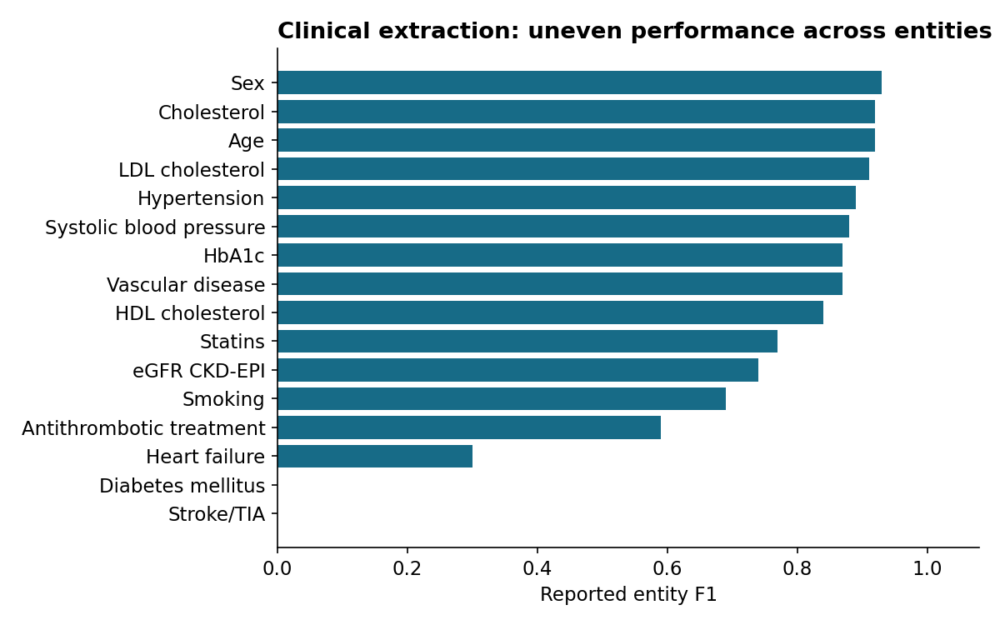

# Clinical Entity Extraction with a Fine-Tuned Language Model

An academic NLP workflow for extracting structured cardiovascular information from German clinical letters. The project connects annotation parsing, supervised fine-tuning and entity-level error analysis. It is a research prototype; no clinical documents, patient examples or trained weights are distributed here.

## Problem and approach

Clinical letters express risk factors, laboratory values and medications in free text. The implementation converts UIMA/XMI annotations into JSON, trains a language model to return structured annotations, and compares generated entities with the supplied references.

The training notebook uses `unsloth/Meta-Llama-3.1-8B-Instruct-bnb-4bit` with rank-stabilized LoRA (rank 16, alpha 16) for one epoch. Although the model identifier contains “4bit”, the training call sets `load_in_4bit=False`; this portfolio therefore does not describe the experiment as verified QLoRA training. Pydantic defines the response schema, and the inference notebook includes JSON repair, entity evaluation and exploratory cardiovascular score calculations.

## Implementation

| File | Responsibility |
|---|---|
| [parse_annotations.ipynb](parse_annotations.ipynb) | Read annotation types and XMI files; extract spans and structured fields |
| [prepare_training_data.ipynb](prepare_training_data.ipynb) | Prepare chat-formatted examples and fine-tune the model |
| [model_inference.ipynb](model_inference.ipynb) | Generate predictions, parse entities and inspect evaluation results |
| [results/entity_metrics.csv](results/entity_metrics.csv) | Transcribed aggregate metrics from the original presentation |

**Technologies:** Python, PyTorch, Transformers, Unsloth, PEFT/LoRA, TRL, Hugging Face Datasets, Pydantic, DKPro Cassis, pandas and Matplotlib.

## Recorded results

The supplied presentation describes 245 annotated letters, and the inference loop processes 49 test entries. Reported entity F1 varies substantially:

| Entity | Reported F1 |
|---|---:|
| Sex | 0.93 |
| Age | 0.92 |
| Cholesterol | 0.92 |
| Hypertension | 0.89 |
| Heart failure | 0.30 |
| Diabetes mellitus | 0.00 |

The full table and original aggregate figures are retained. These are presentation-reported values, not a new evaluation. The source table has support/count inconsistencies, and the implemented matching is not a standard one-to-one span evaluator. See [Results and interpretation](RESULTS.md).

## Inspect or run

Inspect the notebooks and aggregate results without accessing clinical data. To execute the workflow, first supply authorized inputs described in [DATA.md](DATA.md), create a separate Python environment, install the packages in [requirements.txt](requirements.txt), and open JupyterLab from this directory.

Run annotation parsing, training preparation, and inference in that order. A compatible CUDA/Unsloth environment is required by the original implementation; the inference loop explicitly sends tensors to CUDA. The dependency list is import-derived and not a tested lockfile.

## Limitations and preserved issues

- The evaluation notebook expects an intermediate CSV whose complete generation step is not supplied.
- Training and inference refer to separate checkpoint directories; transferring the intended checkpoint requires an explicit local setup decision.
- The fixed 49-entry inference loop is not a general dataset iterator.
- Substring matching, non-exclusive entity matches and inconsistent support counts limit interpretation. Score calculations contain label-handling inconsistencies and are not clinically validated.
- Some cells print clinical spans or write patient-level outputs when executed. Those outputs are absent here and must remain private on any future run.

Original executable cells are preserved apart from replacing personal filenames and institutional absolute paths with neutral relative paths. No training or clinical inference was rerun during preparation.

