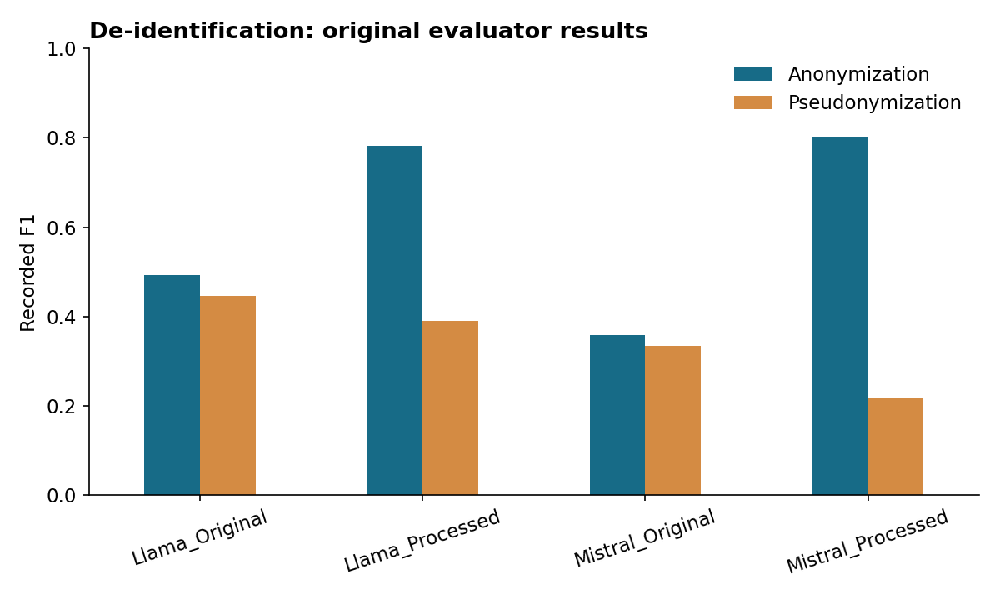

# Clinical Text De-identification

This project explores anonymization and token-based pseudonymization of German clinical text using direct LLM processing and a regex-preprocessed workflow. The public release contains source code, prompts and aggregate evaluation evidence only.

## Research question

The project compares direct LLM processing of German clinical text with a regex-preprocessed workflow. It investigates anonymization and token-based pseudonymization using Llama and Mistral models.

The workflow normalizes text/annotations, identifies structured patterns with regular expressions, runs two LLM processing variants, and evaluates their outputs against annotated spans. Pseudonym mappings are reversible and require separate protection.

## Implementation

| File | Role |
|---|---|
| [data_preparation_final.ipynb](data_preparation_final.ipynb) | Convert the annotated corpus into the pipeline input |
| [Regex_final.ipynb](Regex_final.ipynb) | Rule-based preprocessing and placeholder mappings |
| [llm_deident_pipeline_original_final.ipynb](llm_deident_pipeline_original_final.ipynb) | Process original text |
| [llm_deident_pipeline_processed_final.ipynb](llm_deident_pipeline_processed_final.ipynb) | Process regex-prepared text |
| [final_evaluation.ipynb](final_evaluation.ipynb) | Original evaluation logic |
| [final_prompt.txt](final_prompt.txt) | Prompt template with neutral illustrative names |

**Technologies:** Python, regular expressions, JSON, Transformers, PyTorch, local language models, pandas and span-based evaluation logic.

## Recorded comparison

The original evaluation workbook reports:

| Model/input | Anonymization F1 | Pseudonymization F1 |
|---|---:|---:|
| Llama, original | 0.4926 | 0.4472 |
| Llama, regex-processed | 0.7827 | 0.3899 |
| Mistral, original | 0.3585 | 0.3348 |
| Mistral, regex-processed | 0.8031 | 0.2182 |

These are results of the **original evaluator**, which has material scoring flaws. They do not establish safe anonymization or a validated improvement. [RESULTS.md](RESULTS.md) explains the distinction and retains aggregate counts.

## What this copy preserves

All five final notebooks retain their implementation with neutral illustrative examples. Stored outputs and notebook metadata have been cleared. The source corpus, reversible mappings, document-level outputs, error reports, model checkpoints and credentials are not included.

## Execution status

This is a research prototype, not a validated de-identification system. The original-text LLM pipeline includes an indentation error in code cell 14 (zero-based index), and the preprocessing hand-off requires a manual step. These implementation issues are documented rather than presented as resolved.

Read [DATA.md](DATA.md) for missing inputs and reproduction gaps, and [LIMITATIONS.md](LIMITATIONS.md) for evaluation and implementation caveats. Use only data and environments you are authorized to process. Future runs can write raw text and reversible mappings, even though this release contains neither.
