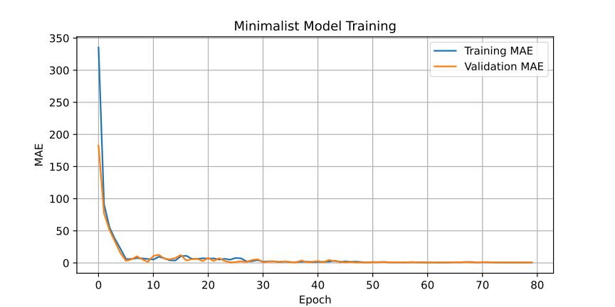

# Compact CNN for Object Counting

A small convolutional neural network that predicts the number of objects in a grayscale image. The project demonstrates image preprocessing, regression-oriented architecture design, training schedules and validation-based checkpoint selection.

## Method

The original [train.py](train.py) reads PNG images, extracts the target count from an `O<number>` filename pattern and normalizes pixels to [0, 1]. Inputs are expected to be **600 × 800 × 1**.

The network applies random horizontal/vertical flips, three convolutional layers with 8, 16 and 24 filters, average pooling, global average pooling and a single linear output. This yields **4,881 trainable parameters** without a large fully connected head.

Training uses an 80/20 train/validation split with seed 42, batch size 16, 80 epochs, Adam with cosine learning-rate decay, and mean absolute error (MAE). The checkpoint with the lowest validation loss is reloaded for test evaluation.

**Technologies:** Python, TensorFlow/Keras, OpenCV, NumPy, scikit-learn and Matplotlib.

## Recorded evidence

| Measure | Source-reported value |
|---|---:|
| Test MAE | 0.8804 objects/image |
| Standard deviation of absolute errors | 0.6631 |
| Trainable parameters | 4,881 |



The learning curve was rendered from the original PDF. [test_metrics.json](results/test_metrics.json) records the report's values, and [saved_model_config.json](results/saved_model_config.json) preserves the saved Keras architecture without weights. See [RESULTS.md](RESULTS.md) for provenance.

## Run

Provide the image folders specified in [DATA.md](DATA.md), install [requirements.txt](requirements.txt) in a separate environment, and run from this directory:

```bash
python train.py
```

The script writes `micro_model.keras` and `loss_graph.pdf`. These are generated artifacts and are ignored by the portfolio's Git configuration. Training runs at top level, so importing the file also starts its workflow.

## Limitations

The loader does not resize images or validate their dimensions; mismatched inputs can fail. The original report does not establish the test-set size or provide per-image predictions, confidence intervals or multiple-seed experiments. The standard deviation above describes absolute errors, not uncertainty in the mean. A linear output does not constrain predictions to non-negative integer counts.

The source implementation is byte-for-byte unchanged. Dataset images and trained weights are excluded; no training or test inference was rerun during portfolio preparation.

