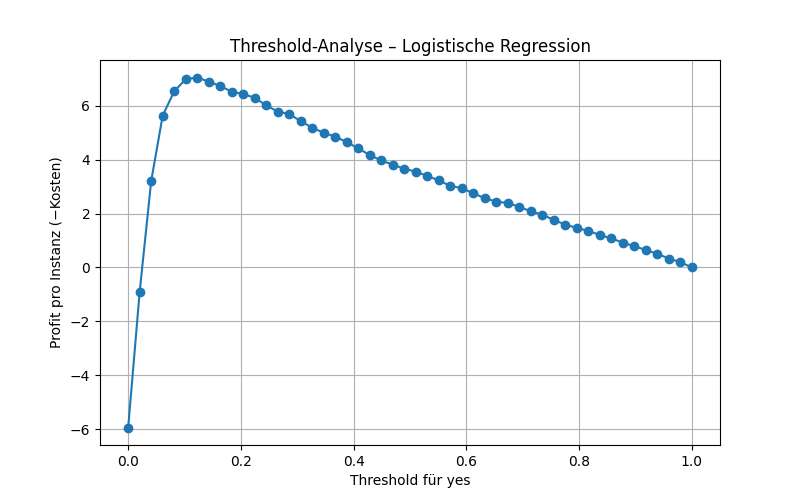
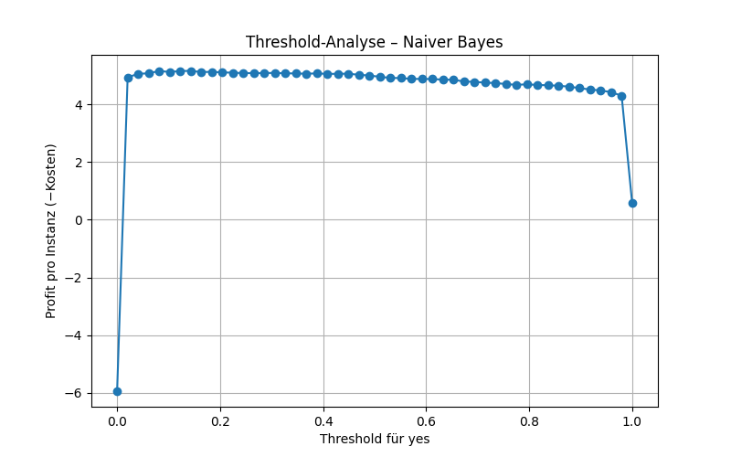

# Cost-Sensitive Classification for Campaign Decisions

A modular tabular machine-learning project that compares logistic regression and Gaussian Naive Bayes using explicit business costs. Its central question is how sampling and probability thresholds affect the decision to contact a potential customer.

## Method

The workflow loads separate training and test CSVs, encodes categorical variables, and creates a stratified 80/20 development split with seed 42. Logistic regression uses feature scaling; Gaussian Naive Bayes provides a contrasting probabilistic baseline.

Two experiments are implemented: a search over positive-to-negative sampling ratios and a sweep over 50 probability thresholds. The threshold analysis uses unsampled training data; the best sampling ratio is not carried into that final experiment.

The original decision cost matrix uses **prediction as the first index and true label as the second**:

| Decision | Actual negative | Actual positive |
|---|---:|---:|
| Do not contact (0) | 0 | 0 |
| Contact (1) | 20 | −100 |

Negative cost represents benefit in this simplified coursework model. The plotted profit is minus total cost divided by the number of evaluated cases.

## Implementation

| File | Role |
|---|---|
| [main.py](main.py) | Command-line orchestration, model comparison, threshold plots and test evaluation |
| [model_utils.py](model_utils.py) | Loading, preprocessing, resampling, training and cost functions |
| [requirements.txt](requirements.txt) | Original Python dependency list |

**Technologies:** Python, pandas, NumPy, scikit-learn, Matplotlib, logistic regression and Gaussian Naive Bayes.

## Recorded evidence

The supplied files contain **40,690 training rows** and **4,521 test rows**. Original threshold plots are retained:




No exact final test profit or accuracy is claimed: the archive does not include a reliable numeric run summary. The curves preserve the available experimental evidence. See [RESULTS.md](RESULTS.md).

## Run

Provide the CSVs described in [DATA.md](DATA.md), install the original dependencies in a separate environment, and run:

```bash
python main.py --data-dir /path/to/authorized-data
```

The actual training filename is `final-bank.csv`, despite the CLI help mentioning `bank-full.csv`. Run from this directory to place generated plots here.

## Limitations

Independent dummy encoding of training and test tables does not explicitly align columns. The resampling helper can fail to achieve a requested lower positive ratio. Sampling optimization and threshold optimization are separate, so the final result is not a jointly optimized pipeline.

The input includes call duration; that feature would be unavailable when deciding whether to make a call and can make a pre-call deployment evaluation misleading. Exact full-row overlap was not found between the supplied train/test files, but that does not establish customer-level independence.

Both source modules and the original dependency file are unchanged. Data files and generated local environments are excluded.

