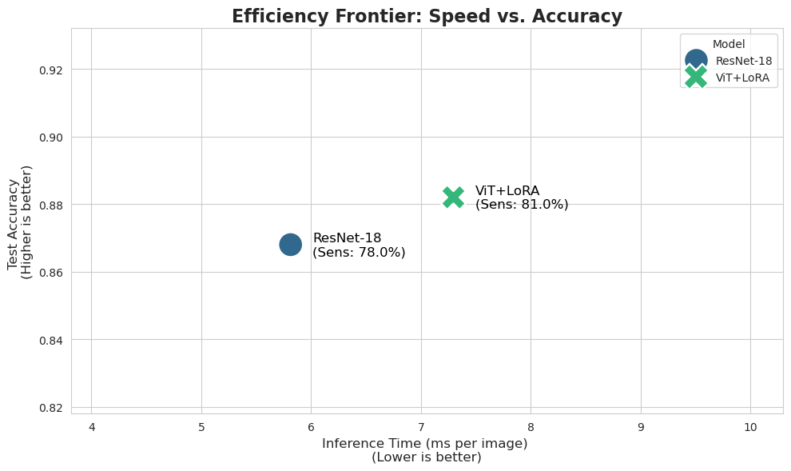

# Diabetic Retinopathy Classification

**ResNet-18 versus a Vision Transformer adapted with LoRA for severe versus non-severe retinopathy.**

The project maps five severity grades to a binary task: grades 0–2 are non-severe, and grades 3–4 are severe. It combines transfer learning, class-weighted optimization, validation-based checkpoint selection and analysis of quality, computational cost and errors.

## Method and implementation

- **ResNet-18:** ImageNet-pretrained backbone, two-output head, weighted cross-entropy, AdamW, cosine scheduling and 15 epochs. Augmentation includes random crops, horizontal flips, small rotations and color jitter.
- **ViT+LoRA:** `google/vit-base-patch16-224-in21k`; LoRA on query/value projections with rank 8, alpha 16 and dropout 0.05; trainable classification head and 10 epochs.
- **Analysis:** classification reports, confusion matrices, inference-loop timing, five-example error inspection, CNN Grad-CAM and transformer attention visualization.

Saved counts are **3,264 training**, **816 validation** and **500 test** images. The test set contains 300 non-severe and 200 severe images. The random split is at image level; patient-level independence is not established.

## Recorded results

| Model | Accuracy | Severe recall | Severe F1 | Recorded ms/image |
|---|---:|---:|---:|---:|
| ResNet-18 | 86.80% | 78.00% | 82.54% | 5.81 |
| ViT+LoRA | 88.20% | 81.00% | 84.60% | 7.29 |

ViT+LoRA has **296,450 trainable parameters**, about **0.3443%** of its 86,096,644 total parameters. This supports parameter-efficient adaptation; it does not imply a smaller deployed backbone or faster inference.



The values come from saved notebook outputs. [RESULTS.md](RESULTS.md) contains the confusion matrices, learning curves and machine-readable comparison.

## Technology and usage

Python, PyTorch, torchvision, Transformers, PEFT, scikit-learn, NumPy, pandas, Matplotlib, seaborn, OpenCV and Grad-CAM.

Open [retinopathy_classification.ipynb](retinopathy_classification.ipynb) to inspect code and retained aggregate outputs. For reproduction, use a dedicated environment and the data described in [DATA.md]. From this directory:

```bash
python -m pip install -r requirements.txt
python -m jupyterlab
```

Dependencies are inferred, not a tested lockfile. Select compatible PyTorch/CUDA builds for your hardware. Review the notebook's original installation cell before executing it. Training generates local checkpoints excluded by `.gitignore`.

## Limitations

The observed 1.4-percentage-point accuracy difference is from one saved run, with no repeated-seed or external validation. Models differ in pretraining, preprocessing, augmentation and schedules; the comparison does not isolate LoRA's causal contribution. Timing includes data loading/transfers and lacks a recorded hardware model.

Grad-CAM targets the ground-truth class; ViT maps show average CLS-token attention. Neither proves lesion detection or clinical safety. The first five recorded errors are all false positives, not a representative sample of errors. Retinal-image outputs are withheld pending source-image redistribution review; the visualization code is unchanged.

Executable cells are preserved. Identifying metadata and author text were removed, and overstated narrative claims were qualified against the evidence. This is collaborative academic work, not a clinically validated system.

