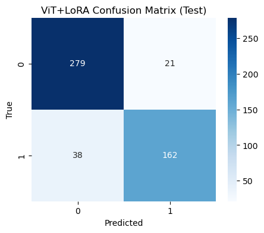
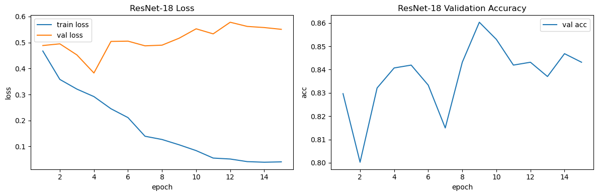
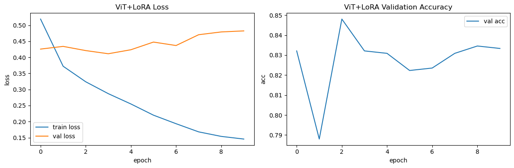

# Recorded results and evidence

Source: the submitted notebook's saved outputs. Metrics were checked against the embedded confusion matrices; models were not rerun.

| Model | TP | FN | FP | TN | Specificity |
|---|---:|---:|---:|---:|---:|
| ResNet-18 | 156 | 44 | 22 | 278 | 92.67% |
| ViT+LoRA | 162 | 38 | 21 | 279 | 93.00% |

Machine-readable values: [model_comparison.csv](results/model_comparison.csv).

The source figures' pixels are preserved; ancillary PNG metadata was removed. The notebook introduction's approximate image count was corrected using saved counts. Retained outputs do not certify that the notebook runs cleanly in a new environment.

