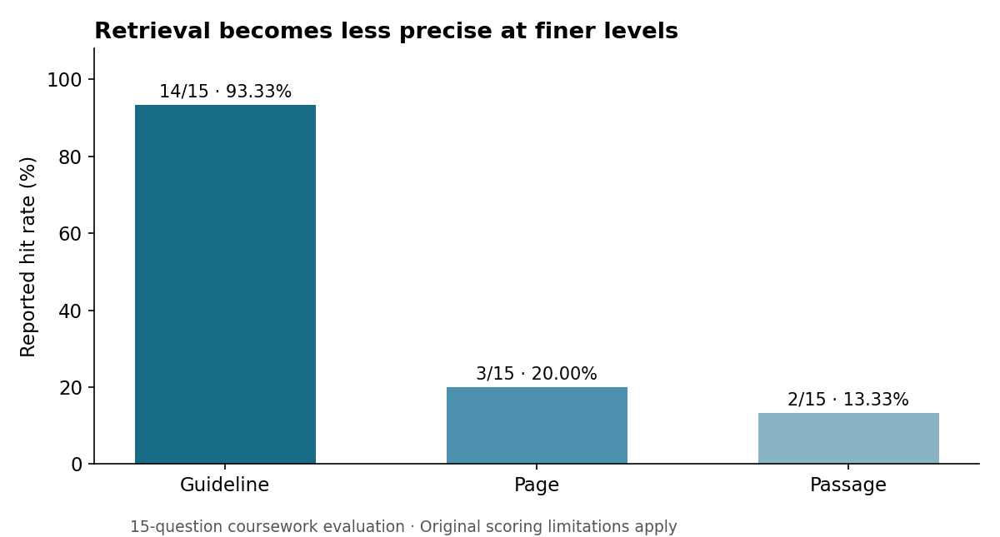

# Medical Guideline Retrieval-Augmented Generation

**A local PDF question-answering pipeline with evaluation at guideline, page and passage levels.**

The implementation retrieves evidence from guideline PDFs before asking a local LLM to compose a German answer with sources. Its main contribution is the ingestion/retrieval/generation workflow and a transparent examination of where relevant-document retrieval fails to yield precise passages.

## Architecture

`MedicalGuidelineRAG` separates initialization, loading, indexing, retrieval and answering. A dataclass centralizes settings; an interactive CLI exposes questions and evaluation.

| Component | Original configuration |
|---|---|
| Ingestion | LangChain `PyPDFLoader` |
| Chunking | 1,500 characters; 200-character overlap |
| Embeddings | `BAAI/bge-m3`, normalized vectors |
| Storage | Persistent Chroma |
| Retrieval | MMR; k=6; fetch_k=80; lambda=0.15 |
| Generator | Ollama `llama3`; temperature 0 |
| Passage matching | Normalized text and `SequenceMatcher`; threshold 0.9 |

## Recorded evaluation

| Level | Hits / questions | Hit rate |
|---|---:|---:|
| Guideline | 14 / 15 | 93.33% |
| Page | 3 / 15 | 20.00% |
| Passage | 2 / 15 | 13.33% |



These are historical retrieval results from the submitted presentation, not answer accuracy or clinical validation. Counts follow from the percentages and denominator. See [RESULTS.md](RESULTS.md) for evidence and scoring caveats.

## Technology and usage

Python, LangChain, Chroma, Hugging Face embeddings, Ollama and PDF/text processing. In a dedicated environment, obtain the inputs in [DATA.md], install and start Ollama separately, then run from this directory:

```bash
python -m pip install -r requirements.txt
ollama pull llama3
python PML_Aufgabe6_RAG.py
```

Ollama must serve the configured model; embedding initialization may download weights. CLI commands are `ask <question>`, `eval_gold`, `eval_retrieval` and `q`. Evaluation also needs the full private gold file. The included question index is documentation, not a substitute benchmark. The script is byte-identical to the original and was not run against a live model during preparation.

## Limitations

Guideline precision deduplicates IDs but divides by the number of requested chunks. Passage matching can count text from the wrong source. Generation formatting removes additional chunks from the same source/page pair. These behaviors are preserved; corrected scores would be a new experiment.

Fifteen questions provide limited coverage. Low passage performance cannot be attributed solely to strict matching. Some source filenames indicate historical/expired guideline versions. This is an academic retrieval experiment, not current medical guidance.

