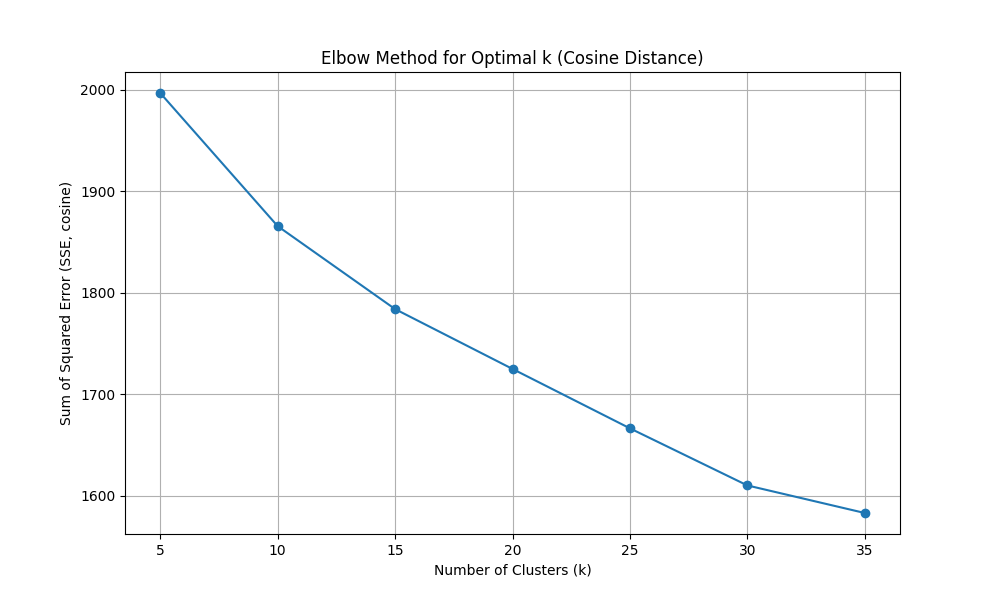

# Unsupervised Text Clustering with TF–IDF

A Python workflow for discovering themes in a collection of web pages. The project implements cosine-distance clustering directly and connects preprocessing choices with interpretable cluster terms.

## Approach

The supplied run covers **3,526 documents**. Titles receive fivefold weighting before text is converted into TF–IDF features. Preprocessing combines German and English stopwords with German stemming; terms must appear in at least five documents.

The custom clustering routine alternates assignments and centroid updates using cosine distance, with multiple random initializations. An elbow study compares cluster counts from 5 to 35; the final configuration explicitly selects **15 clusters**. This is a chosen hyperparameter, not an automatically inferred optimum.

**Technologies:** Python, NumPy, SciPy, scikit-learn, NLTK and Matplotlib.

## Implementation and evidence

[clustering_analysis.py](clustering_analysis.py) contains loading, preprocessing, clustering, the elbow analysis and top-term output.



[cluster_terms.txt](results/cluster_terms.txt) preserves ten representative terms for each of the 15 clusters. Personal/institutional name tokens in these aggregate lists were replaced with `[name omitted]`; remaining technical terms and numerical evidence were retained. Stemming means some words appear as stems.

There is no supplied silhouette score, external label comparison or held-out retrieval metric. The elbow plot and terms demonstrate exploratory structure, not verified semantic accuracy. See [RESULTS.md](RESULTS.md).

## Run

Supply the local JSON input described in [DATA.md](DATA.md), install [requirements.txt](requirements.txt) in an isolated environment, and run:

```bash
python clustering_analysis.py
```

The code requests NLTK resources at startup, so the first run may require network access. Output files are generated under `app/output/`.

## Limitations and preservation

Cluster interpretation is qualitative and depends on the original corpus, title weighting, vocabulary filters and initialization. The custom algorithm should not be assumed equivalent to scikit-learn's Euclidean KMeans. At an iteration limit, returned assignments are not recomputed against the final updated centroids.

The only source change is replacing an institution-specific input filename with `webpages.json`. The algorithm is unchanged. The roughly 102 MB source corpus, which includes names and contact information, is excluded. No corpus crawl or clustering rerun was performed during preparation.

